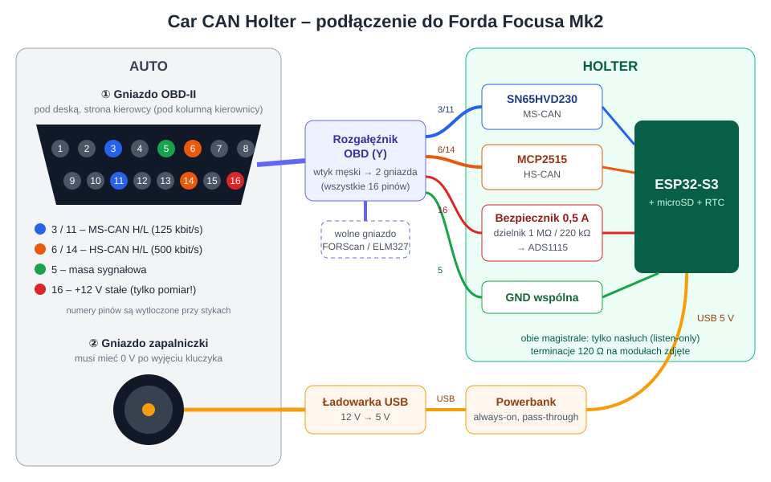
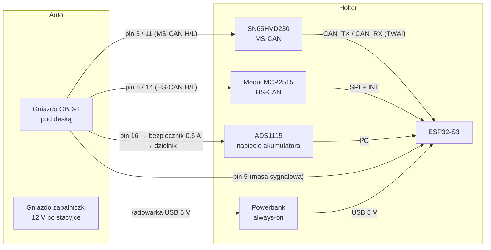

# Podłączenie do Forda Focusa Mk2

Wariant wg D-006: holter zasilany z powerbanka, ładowanego z gniazda zapalniczki tylko w czasie jazdy.
Z gniazda OBD-II bierzemy wyłącznie sygnały CAN, masę i pomiar napięcia.



## Schemat blokowy



## Piny gniazda OBD-II (patrząc na gniazdo w aucie; numery są zwykle wytłoczone obok styków)

```
  ┌───────────────────────────────┐
   \  1   2   3   4   5   6   7   8 /
    \ 9  10  11  12  13  14  15  16/
     └───────────────────────────┘
```

| Pin OBD | Sygnał w Focusie Mk2 | Dokąd w holterze |
|---|---|---|
| **3** | MS-CAN H (125 kbit/s) | SN65HVD230 – CANH |
| **11** | MS-CAN L | SN65HVD230 – CANL |
| **6** | HS-CAN H (500 kbit/s) | moduł MCP2515 – H |
| **14** | HS-CAN L | moduł MCP2515 – L |
| **5** | masa sygnałowa | GND holtera (wspólna masa – **wymagana** dla CAN) |
| **16** | +12 V stałe (z akumulatora) | **tylko** bezpiecznik 0,5 A → dzielnik 1 MΩ / 220 kΩ → ADS1115 A0 |
| 4 | masa nadwozia | nie podłączać (wystarczy pin 5) |

Przypisanie MS-CAN do pinów 3/11 jest typowe dla Forda – **sprawdź pomiarem przed podłączeniem** (niżej).

## Krok po kroku

### 1. Sprawdzenie gniazda (multimetr, auto zamknięte i uśpione, kluczyk wyjęty)

| Pomiar | Oczekiwany wynik | Co oznacza |
|---|---|---|
| Rezystancja pin 6 ↔ 14 | ~60 Ω | HS-CAN jest, terminowany na obu końcach |
| Rezystancja pin 3 ↔ 11 | ~60 Ω | MS-CAN jest |
| Napięcie pin 16 ↔ 5 | 12,2–12,8 V | stałe zasilanie |
| Napięcie gniazda zapalniczki po wyjęciu kluczyka | 0 V | gniazdo po stacyjce – OK do ładowania powerbanka |

Jeśli zapalniczka ma 12 V bez kluczyka – **nie** ładować z niej (ładowarka ciągnęłaby prąd na postoju);
wtedy potrzebny układ włączający ładowanie przy > 13,2 V.

### 2. Przygotowanie modułów (na stole, przed autem)

- **Zdejmij terminację 120 Ω** na obu modułach: na MCP2515 zworka (zwykle J1), na Waveshare SN65HVD230
  sprawdź rezystancję CANH↔CANL – ~120 Ω oznacza rezystor do wylutowania.
  Po zdjęciu: bez zasilania CANH↔CANL ≫ 120 Ω.
- Firmware w trybie **listen-only** na obu magistralach (MCP2515: tryb Listen-Only; TWAI: `TWAI_MODE_LISTEN_ONLY`).
- Prędkości: MS-CAN **125 kbit/s**, HS-CAN **500 kbit/s**; w MCP2515 ustaw właściwy kwarc (8 lub 16 MHz).

### 3. Okablowanie

- Każda magistrala na **osobnej skrętce** (np. para z kabla sieciowego), odcinek od gniazda do modułu jak najkrótszy (< 50 cm).
- Pin 16: bezpiecznik 0,5 A **jak najbliżej wtyku**, dalej dzielnik:

```
pin 16 ──[bezp. 0,5 A]──[1 MΩ]──┬──────────── ADS1115 A0
                                 │
                               [220 kΩ]  [100 nF]   BAT54S: A0 do GND i do 3,3 V (ogranicznik)
                                 │          │
pin 5 (GND) ─────────────────────┴──────────┴──── GND holtera
```

  15 V → ~2,7 V na A0; pobór z akumulatora ~12 µA.
- Masa: pin 5 OBD = GND ESP32 = GND obu modułów CAN = GND ADS1115. Powerbank łączy się z ESP32 po USB.

### 4. Pierwsze uruchomienie w aucie

1. Holter włączony i nagrywający **zanim** wepniesz wtyk OBD (listen-only już aktywny).
2. Wepnij rozgałęźnik OBD, potem przekręć kluczyk w pozycję II (zapłon, bez rozruchu).
3. Sprawdź w logu, że na obu magistralach są ramki i **nie rośnie licznik błędów** (TEC/REC, error passive).
   Błędy = zła prędkość lub zamienione H/L → odłącz i popraw.
4. Uruchom silnik, przejedź się, zgaś, zamknij auto. Holter zostaje i nagrywa zasypianie modułów.

### 5. Montaż

- Rozgałęźnik OBD pod deską; holter w obudowie przypięty opaskami, z dala od pedałów i poduszek powietrznych.
- Powerbank nie na słońcu (deska rozdzielcza latem → przegrzanie ogniwa).

## Bezpieczeństwo

- Holter **nigdy nie nadaje** na magistralę (listen-only). Tryb normalny przy złej prędkości generuje ramki błędów
  i może wywołać kontrolki/błędy w sterownikach.
- Nie podłączaj nic do pinu 16 bez bezpiecznika.
- Przy pierwszych testach miej możliwość szybkiego wypięcia wtyku OBD.
